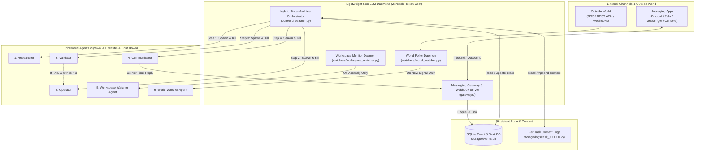

# Antigravity Autonomous Ephemeral Workspace

An event-driven, multi-agent workspace where **every agent is spawned exclusively for its assigned step and immediately shut down upon completion**. Context is persisted in per-task Markdown log files (`storage/logs/task_<id>.log`), and every lifecycle transition, spawn, shutdown, and watcher trigger is recorded in a local **SQLite (WAL)** database (`storage/events.db`).

---

## Architecture & Working Loop



### Why this Hybrid Loop Works Best
1. **Zero Idle Token Burn**: The 2 Watchers (`workspace_watcher` and `world_watcher`) use lightweight Python checks for file changes, stuck SQLite tasks, and RSS/API deduplication, spawning an LLM agent **only** when an anomaly or unseen external item is found.
2. **Bounded Validation Loop**: If `Validator` outputs `VERDICT: FAIL`, the Orchestrator routes the feedback back to `Operator` up to `max_validation_retries` (default `3`) before escalating to the user via `Communicator`.
3. **Role-Agnostic Pluggable Providers**: By default, roles run via **headless Antigravity CLI (`agy --print`)** which requires **no API key**. Any role can be switched independently to OpenAI/Ollama (`http_llm`), Gemini REST (`gemini_http`), or any custom CLI in `config/workflow_config.json`.

---

## Quickstart Commands

### 1. Test the Full Ephemeral Loop (Dry-Run Mode)
Verify the state machine, SQLite event logging, and context log generation instantly:
```powershell
python main.py run "Create a utility script" --dry-run
```

### 2. Run a Real Task with Headless Antigravity (`agy`)
Executes `researcher` -> `operator` -> `validator` -> `communicator` using headless `agy`:
```powershell
python main.py run "Create a Python script fib.py that prints the first 10 Fibonacci numbers"
```

### 3. Inspect SQLite Events & Tasks
```powershell
python main.py status
python main.py logs 1
```

### 4. Change the Agent Provider for Any Role
Switch any role to another provider defined in `config/workflow_config.json`:
```powershell
python main.py set-role-provider researcher gemini_rest_api
python main.py set-role-provider researcher agy_headless_safe
```

### 5. Start the 24/7 Autonomous Daemon & Messaging Webhook Server
```powershell
python main.py daemon
```
Once running, you can send tasks via HTTP/Discord/Zalo/Messenger webhooks:
```powershell
Invoke-RestMethod -Method Post -Uri "http://127.0.0.1:8080/webhook/task" `
  -ContentType "application/json" `
  -Body '{"prompt": "Check workspace status", "channel": "console", "user": "admin"}'
```
