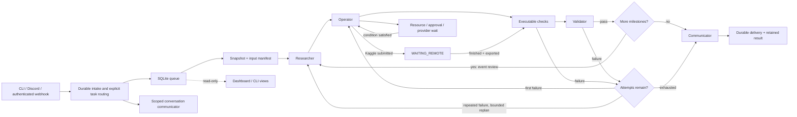

# Architecture

The deterministic controller owns state, budgets, queueing and evidence.
Providers implement `run_role` and return a common result. No CLI needs to be
the permanent main driver: every role can use a different provider/model.

## Ralph loop

Inspect → implement one item → run checks → independently validate → checkpoint
verified work → continue. The researcher may provide a direct brief or a
`research_plan` block with backend, milestones and executable checks. A plain
brief remains direct. `{python}` resolves to the controller's interpreter.

The default is three total attempts per item. After two failures the researcher
may revise the remaining strategy once. Attempts/time do not reset. Replanning
cannot change the backend, remove executable checks or change verified steps.
Malformed revisions escalate. Submitted/uncertain remote jobs are not replanned
or resubmitted automatically. An explicit recovery receives a fresh task ID.

Check failures override a model PASS. A successful validator process is not a
passing validation. One explicit verdict and following evidence are required;
missing, duplicate, contradictory, quoted or fenced verdicts fail. CLI progress
before the final verdict is allowed.

## State and headless conversations

| Location | Content |
|---|---|
| `storage/events.db` | Tasks, events, role runs, leases and delivery outbox |
| `storage/inputs/task_<id>/` | Hashed copies of explicitly supplied files |
| `storage/workspaces/task_<id>/` | Isolated source, inputs and results |
| Task `.workflow/` | Plan revisions, handoff, progress, timeline, hook receipts |
| Task `.workflow/roles/` | Separate role histories and native session identities |
| `storage/conversations/` | User/channel-scoped conversation communicator |
| `storage/resource-control/` | Persistent Colab ownership/generation and operation lock |
| `storage/logs/agent_runs/task_<id>/` | Prompts, live stdout/stderr and result receipts |

Run names follow `task-00019/step-03/validator/attempt-02`. Filenames add a UTC
timestamp. Codex/OpenCode provider session IDs are retained when emitted.
Old logs keep their original paths and receive a legacy display name. The task
timeline and dashboard group runs without merging sessions between tasks.

Full context persists on disk. Resumed or rotated roles receive the original request, plan,
current step and bounded research/result/feedback excerpts, plus handoff/log
paths. This avoids repeated whole-transcript injection; it is not automatic
long-term research memory.

## Sophisticated work

Milestones, executable checks, preserved evidence and bounded replanning help
with longer experiments. Supply the paper/source, data locations, target metric,
compute limit and completion criteria. See [the example brief](../examples/research_task.md).

Milestones execute sequentially; this is not a task dependency graph or an
unbounded parallel team. At most three independent tasks run. A smoke test cannot
establish full paper reproduction. Validation must match the requested experiment.
Provider role settings differ and do not replace an OS sandbox.

Personal Colab is a shared serialized browser resource, not a fleet of isolated
VMs. Worker expiry escalates rather than replaying uncertain shell/GPU actions.
Remote jobs may outlive local workers. Bridge release is not VM shutdown.

## Component map

| Code | Responsibility |
|---|---|
| `main.py`, `core/configuration.py` | Commands and validated settings |
| `core/orchestrator.py`, `core/plans.py` | State machine, checks, bounded repair |
| `core/database.py`, `core/scheduler.py` | Durable queue and task ownership |
| `core/conversation.py`, `core/role_memory.py` | Conversation routing and scoped memory |
| `core/control.py`, `core/approvals.py`, `core/resource_gate.py` | Waits, exact approvals, Colab fencing |
| `core/checkpoints.py`, `core/compute.py` | Durable computation state and disabled future adapters |
| `core/workspaces.py`, `core/inputs.py` | Isolation and supplied input snapshots |
| `core/providers.py`, `core/tools.py`, `core/processes.py` | CLI/API execution and tools |
| `core/integrations.py`, `scripts/agent_hooks.py` | Generated hooks and skills |
| `core/cloud.py`, `core/colab_*`, `core/mcp_client.py` | Local kernels and cloud adapters |
| `gateways/`, `watchers/` | Optional messaging and event monitors |
| `core/observability.py`, `core/dashboard.py`, `ui/` | Read-only live views |
