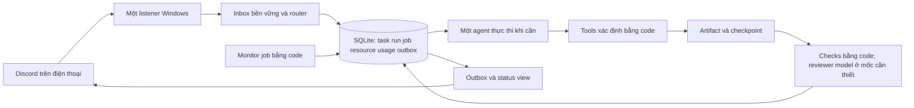

# Phân tích độc lập usage agent và workflow tối giản — 09/11/2026

Mục tiêu là hoàn thành nhiều công việc đạt acceptance hơn trong hạn mức subscription đang có, đồng thời có thể giao việc và theo dõi từ Discord trên điện thoại. Việc máy Windows chạy liên tục không đòi hỏi model chạy liên tục.

Kết luận chính: ưu tiên giảm các lần gọi model không tạo tiến triển, thu gọn context theo công việc, sửa cách đo usage giữa provider và bảo toàn job khi hết quota. Chưa có cơ sở để nói giảm được bao nhiêu phần trăm quota. Chỉ giảm độ dài câu trả lời sẽ bỏ qua phần lớn lượng token Codex được quan sát, nhưng cũng không được coi output là miễn phí vì tỷ trọng token nhỏ.

Đây là phân tích và probe offline. Không sửa core, supervisor, cấu hình runtime, startup hay power; không gọi agent/provider mới, mở GPU, gửi Discord hoặc triển khai dịch vụ. Các file handoff gốc giữ nguyên. Các contribution là ý kiến từ snapshot, không phải hai cuộc kiểm chứng source độc lập.

## 1. Phạm vi và độ tin cậy

Đã đọc START_HERE, PRELIMINARY_REPORT_VI, CODEX_CAMPAIGN_TOTAL, SOURCE_EVIDENCE, cả hai contribution, các script tạo số liệu, token snapshot/CSV, native receipts và các đoạn source liên quan. Đã đọc ledger Codex gốc theo đúng năm thread được liệt kê trong handoff, không tìm token toàn tài khoản.

Kết quả kiểm tại thời điểm chạy script:

| Kiểm tra | Kết quả |
|---|---|
| Hash file trong BUNDLE_SHA256 | 36/36 khớp |
| Hash source hiện tại với SOURCE_EVIDENCE | 6/6 khớp |
| Tổng năm thành phần campaign với ledger gốc | 5/5 khớp |
| Response Codex trong phạm vi campaign | 600, không trùng giữa các thành phần |
| Duplicate/conflicting response records trong các source đã đọc | 0/0 |
| Invariant cache≤input, reasoning≤output, total=input+output | Không thấy vi phạm trong các ledger đã đọc |
| Snapshot packaging ở cutoff đã ghi | Khớp 4.986.464 token |
| Ba test ledger có sẵn | PASS |
| Kiểm Discord bằng điện thoại, restore Drive hay quota live | Không thực hiện |

Tái kiểm bằng `python -B docs/reviews/2026-11-09-usage/independent_audit.py`. Kết quả số trong [INDEPENDENT_EVIDENCE.json](INDEPENDENT_EVIDENCE.json), breakdown từng turn trong [INDEPENDENT_TURNS.csv](INDEPENDENT_TURNS.csv). Script chỉ xuất số, định danh, đường dẫn và hash; không xuất nội dung hội thoại/tool/reasoning. Đọc raw diễn ra tại máy này.

Ba mức bằng chứng được dùng xuyên suốt: **đo lại** là đã tính lại từ ledger/hash; **probe offline** là chạy code thật với adapter giả; **source/rủi ro** là suy ra từ code, chưa phải lỗi tái hiện trên dịch vụ thật. Tình trạng GPU/Drive và kết quả khoa học trong handoff là bằng chứng lịch sử, không được xác nhận lại bằng truy cập dịch vụ trong lần này. Giữ nguyên reproduction PARTIAL/P6 UNRESOLVED; không biến review PASS thành scientific PASS.

## 2. Token Codex: đếm đúng và đọc đúng

### 2.1 Bốn nhóm không chồng lấn

| Nhóm | Số token | % tổng processed |
|---|---:|---:|
| Cached input | 112.641.920 | 97,5967% |
| Uncached input | 2.211.429 | 1,9161% |
| Reasoning output | 248.700 | 0,2155% |
| Output còn lại | 313.687 | 0,2718% |
| Tổng | **115.415.736** | 100% sau làm tròn |

`input = 114.853.349`, `output = 562.387`. Cache là **98,0746% input**, không phải 98,0746% quota. Reasoning là tập con output. “Output còn lại” bao gồm nội dung phát ra như văn bản và tham số tool; không đồng nghĩa toàn bộ là câu trả lời cuối mà người dùng nhìn thấy.

```text
uncached_input = input - cached_input
non_reasoning_output = output - reasoning_output
processed = cached_input + uncached_input + reasoning_output + non_reasoning_output
          = input + output
```

Một đoạn tool output có thể đi vào input lần đầu rồi xuất hiện trong cached input của nhiều response sau. Đoạn reasoning/output trước đó có thể ảnh hưởng context các lần sau tùy cách runtime giữ lịch sử. Không được cộng thêm “tool tokens”, “history tokens”, “skill tokens” lên bốn nhóm trên: đó là trục phân loại nội dung khác.

115 triệu processed tokens không phải 115 triệu token duy nhất và không phải 115 triệu token được trừ đồng giá vào gói subscription. OpenAI nêu rõ giá API/credit không xác định số task được bao gồm trong subscription; hạn mức thực tế xem ở usage dashboard hoặc `/status`. Vì vậy chưa xác định được phần trăm quota đã dùng hoặc quota bị lãng phí từ ledger này. [OpenAI pricing](https://learn.chatgpt.com/docs/pricing).

### 2.2 Phân bổ theo agent/thread đã được xác nhận

| Thành phần | Response | Processed | Nhận xét |
|---|---:|---:|---|
| Interactive root trước packaging | 221 | 47.725.354 | 8 yêu cầu của người dùng, mỗi yêu cầu có nhiều response nội bộ |
| Linked Codex guardian | 7 | 342.106 | Model `codex-auto-review`; khác guardian campaign viết riêng |
| Headless Codex operator lịch sử | 140 | 24.663.578 | 11 turn trong cùng thread |
| Older selected turns, thread chính cũ | 230 | 42.626.164 | 13 turn được nhận diện bằng tool path |
| Older selected turn khác | 2 | 58.534 | 1 turn |
| Tổng | **600** | **115.415.736** | Không cộng lặp response |

Một user message, một CLI invocation, một provider turn, một model response và một tool call là các đơn vị khác nhau. Một lần “gọi operator” vẫn có thể tạo hàng chục response suy luận và nhiều lần replay context. Chỉ đếm số process hoặc số tin Discord sẽ bỏ sót phần này.

Linked guardian 7 response là automatic approval review theo metadata trong ledger. Không coi nó là heartbeat tùy chọn để tắt. Guardian Claude của campaign ở phần sau là một nhóm riêng.

### 2.3 Tám yêu cầu root: usage thực sự tập trung ở đâu?

Nhãn dưới đây mô tả ý định user ở mỗi turn; số bao gồm toàn bộ công việc trong turn, không phải phép đo nhân quả rằng toàn bộ token đó là chi phí của một chức năng.

| Yêu cầu trong root, theo thứ tự | Response | Input | Uncached input | Output |
|---|---:|---:|---:|---:|
| Kiểm tra tiến độ ban đầu | 14 | 792.115 | 69.171 | 4.411 |
| Bước kế tiếp, lưu trữ, phục hồi, nguyên nhân dừng | 46 | 6.567.227 | 84.539 | 33.155 |
| Claude có usage trở lại; tiếp tục và xem token | 27 | 6.733.632 | 58.176 | 30.598 |
| Khôi phục task và tiếp tục | 35 | 10.717.073 | 32.273 | 20.971 |
| Quyền Drive và câu hỏi về skill | 9 | 3.139.294 | 20.190 | 16.576 |
| Báo cáo tiến độ sau đó | 6 | 2.274.381 | 371.277 | 5.154 |
| % project, ETA và khả năng dùng thêm tài nguyên | 16 | 5.265.396 | 59.636 | 28.011 |
| Giám định, đối chiếu và đóng nghiên cứu | 68 | 12.025.503 | 169.247 | 71.857 |

Ví dụ turn khôi phục dùng trung bình **306.202 input/response**, dù chỉ thêm 32.273 uncached input trong cả turn. Turn “báo cáo tiến độ” sau đó dùng trung bình **379.064 input/response**; nhưng không thể gọi toàn bộ là polling thừa vì người dùng đã yêu cầu và agent có kiểm chứng thêm. Đây là ứng viên thay bằng status tool khi chỉ cần dữ kiện hiện trạng.

Turn giám định có **2.476.471 ký tự tool output lộ ra trong transcript**, trên tổng 4.235.576 ký tự của 8 turn root. Đây là số ký tự một lần xuất hiện trong log, không phải token và không bao gồm nhân replay. Ledger không cho phép quy chính xác bao nhiêu token input là source code, log, instruction hay history. Không dùng quy tắc “4 ký tự = 1 token” để dựng tỷ trọng giả.

### 2.4 Cutoff và nhược điểm auditor hiện có

Campaign trước packaging: 115.415.736. Snapshot packaging mới hơn: 4.986.464. Cộng hai phạm vi tại cutoff của snapshot: **120.402.200**. Đây không bao gồm toàn bộ final response chưa ghi ledger, và không bao gồm cuộc phân tích hiện tại. `CODEX_CAMPAIGN_TOTAL.packaging_request_so_far = 3.296.500` là snapshot sớm hơn; khác biệt cutoff, không phải mâu thuẫn số học. `CODEX_TOKEN_USAGE.union_totals = 77.717.502` còn có phạm vi hẹp hơn: root+guardian+operator, chưa gồm hai older components. Không so ba tổng như cùng phạm vi.

Auditor hiện có làm đúng nguyên tắc ưu tiên response-level records, không cộng cache/reasoning hai lần và không cộng 11 cumulative CLI totals. Cần sửa thiết kế đo trước khi dùng lâu dài:

1. `codex_usage_audit.py` lấy turn mới nhất làm “current request”. Chạy lại sau một yêu cầu mới có thể đổi mốc pre-packaging. Phải pin `turn_id` và cutoff, không suy từ “newest”.
2. Discovery chỉ tìm ngày 5–9/11, đúng cwd và tool-call arguments chứa `smile-pre-publish`. Có thể bỏ sót chat-only, đường dẫn tương đương, worktree, subprocess/provider khác; có thể đưa toàn bộ turn trộn việc vào campaign. Đây là **heuristic attribution**, không phải lower bound toán học của usage campaign.
3. Khi duplicate response có số khác nhau, code gộp maximum từng field. Có thể tạo một bộ usage chưa từng được provider báo. Nên giữ raw observations, đánh dấu conflict và chỉ chọn observation cuối nếu hợp đồng nguồn cho phép.
4. Fallback cumulative maximum chỉ hợp lệ khi đã xác nhận counter cùng epoch và đơn điệu. Counter reset/đổi nghĩa cần tách epoch hoặc đánh dấu UNKNOWN. Missing usage khác zero usage.
5. Parser bỏ qua mọi JSON lỗi; cần chỉ cho phép trailing partial line của file đang ghi, còn lỗi giữa file phải báo.
6. Ba test hiện có chưa bao phủ cutoff ổn định, mixed-turn scope, counter reset, conflict, cache write của Claude và schema AGY. Test PASS không giải quyết các giới hạn này.

## 3. Claude và AGY: khoảng trống trong báo cáo usage toàn agent

### 3.1 Claude

Với schema Claude, `input_tokens` riêng lẻ không gồm input tạo cache và đọc cache:

```text
input_all = input_tokens + cache_creation_input_tokens + cache_read_input_tokens
processed = input_all + output_tokens
```

Không cộng `thinking_tokens` lên output lần nữa. Các breakdown TTL cache là chi tiết của cache write, không phải nhóm cộng thêm. Đây là công thức usage của API Claude; không phải công thức trừ hạn mức subscription. [Claude prompt caching](https://platform.claude.com/docs/en/build-with-claude/prompt-caching).

Inventory tìm được 92 file native Claude có usage trong các đường dẫn được chọn:

| Nhóm receipt | File | Input sau cache breakpoint | Cache write | Cache read | Output |
|---|---:|---:|---:|---:|---:|
| claude_roles/turns | 35 | 782 | 2.190.545 | 86.058.631 | 438.595 |
| guardian/*.raw.json | 56 | 212 | 1.948.280 | 14.514.190 | 50.109 |
| researcher_opus.raw.json | 1 | 12 | 51.301 | 141.334 | 8.480 |

Đây là **tổng field của receipt được tìm thấy**, chưa được gọi là usage toàn tài khoản hoặc toàn campaign. Trong 35 file claude_roles có 26 receipt nhận diện operator, 7 researcher, 2 chưa có sender trong receipt; không giả gán cả hai vào operator. Nhóm guardian gồm 55 review và một probe, không đồng nghĩa 56 review hữu ích hoặc 56 review thừa.

Đã đối chiếu thêm raw Claude session: 12 session ID từ receipt, tìm được 11 file session; 7 session khớp hoàn toàn giữa tổng unique message ID và receipt chọn; 4 session có raw usage nhiều hơn receipt được chọn, 1 session không có raw file. Ví dụ session `e2731e2c-69aa-4716-9a79-8f5f4a2410a8`: 11 receipt khớp 166 unique message ID; 433 assistant record xuất hiện trong raw cần dedup. Không cộng mọi dòng assistant vì cùng message có thể xuất hiện nhiều lần với các content block.

Các session không khớp cần attribution theo invocation/timestamp/message ID trước khi tổng kết campaign. Không lấy max theo Claude session một cách máy móc: session mẫu trên chứng minh tổng các invocation receipt mới khớp raw, khác cumulative snapshots của Codex/AGY ở những nguồn đã quan sát. Raw cả session và native receipt là hai cách nhìn cùng usage, không được cộng cả hai.

Contribution đóng gói riêng: Claude nhận `2 + 64.109 + 0 = 64.111` input và 3.748 output, tổng **67.859**. Prompt chỉ dài 19.105 ký tự không xác định toàn bộ model input. Tool-disabled không loại toàn bộ instruction/schema/native overhead. Chưa có tracing để chia 64.111 thành từng nguồn; chưa có bằng chứng “64k đều thừa”.

### 3.2 AGY: phát hiện counters tích lũy và cache không cùng quan hệ Codex

Có 77 receipt AGY hoặc wrapper tương ứng trong bốn nhóm dưới. 68 file có cache read lớn hơn input. Ví dụ coordination receipt đầu: `input=40.616`, `cache_read=62.704`, `output=7.620`, `total=48.236`. Do đó không thể coi cache là tập con input theo công thức Codex.

Cùng conversation `0ceec089-748a-4657-a612-af4528fbbbf9`, các receipt có `num_turns=1,2,3,4,5`, và `total=48.236,72.478,93.289,113.643,133.613`. Đây là bằng chứng counters tích lũy qua resume. Trong tập chọn, các field kiểm tra không giảm khi sắp theo num_turns trong từng session.

| Nhóm | Receipt / session | Cộng mọi total receipt — dễ đếm trùng | Tổng maximum total theo session — ứng viên |
|---|---:|---:|---:|
| agy/turns | 13 / 2 | 1.997.024 | 562.258 |
| communication/turns | 14 / 2 | 2.629.249 | 558.450 |
| coordination/turns | 39 / 4 | 8.745.739 | 1.660.705 |
| validation | 11 / 11 | 4.390.677 | 4.390.677 |

“Ứng viên” là cách gộp counters quan sát được, chưa là token total đã chuẩn hóa theo provider. Tổng bốn ứng viên: reported total 7.172.090, trong đó reported input 6.089.495 và output 1.082.595; cache read riêng báo 54.094.207. Quan hệ reported total=input+output khớp nhưng cache chưa được giải thích. Không tự cộng 54 triệu vào tổng rồi tuyên bố đó là usage subscription; cũng không bỏ nó khỏi audit. Cần kiểm mã/hợp đồng wrapper và một response gốc để biết input đang loại cache, phạm vi counter và thinking được tính ra sao.

Một validation stdout rỗng được giữ là missing/unknown usage, không quy thành “không tốn token”. Số receipt tìm thấy phụ thuộc pattern được khai báo trong script, không bảo đảm đã tìm đủ mọi attempt/subagent/session.

Contribution AGY FRESH riêng báo input 15.182, output 5.117, total 20.299 và thinking 3.658; ghi nhận đúng nhãn native. Không so hiệu quả giữa Claude và AGY chỉ từ hai contribution: model, instruction, output, cache và nghĩa usage khác nhau, chưa có acceptance chất lượng chung.

## 4. Phân loại nội dung input/output: giữ gì, giảm gì?

Cache/new là trục kế toán. Bảng sau là trục **mục đích nội dung**. Hiện chưa có số token chính xác cho từng hàng; mọi phần trăm cho từng hàng sẽ là bịa nếu không instrument thêm.

| Nhóm | Nguồn phát sinh | Cần giữ | Cách giảm hợp lý |
|---|---|---|---|
| Instruction hệ thống/provider/quyền | Runtime, sandbox, policy, CLI | Ràng buộc và quyền đang áp dụng | Không lặp lại vào brief; tách phần custom có thể rút gọn; không tắt approval để giảm usage |
| Yêu cầu user và quyết định | Prompt, feedback, acceptance | Mục tiêu, scope, thay đổi đã áp dụng | Giữ request gốc ở file; đưa phần đang liên quan và revision vào context |
| Repo rules, skill và role instructions | CLAUDE.md, skill body, roles | Chỉ dẫn áp dụng cho công việc | Load skill cần thiết; gộp chỉ dẫn trùng; giữ prefix ổn định khi có thể |
| Tool definitions/schema | MCP, function signatures, JSON schema | Tool cần cho phase | Dùng bộ tool nhỏ theo phase và discovery có cấu trúc, không dump toàn catalog |
| Source/tài liệu | Đọc file, web, paper | Đoạn đủ kiểm chứng claim | `rg`/query trước, đọc range, pin hash; khi cần toàn file thì vẫn đọc toàn file |
| Trạng thái/job telemetry | Log/progress/PID/boot/checkpoint | Dữ kiện mới và độ tươi | Tool JSON nhỏ trả delta, timestamp, error, evidence path; log đầy đủ ở disk |
| Lịch sử và bản tự thuật agent | Transcript, role memory, handoff | Quyết định còn hiệu lực, issue chưa giải quyết | Một state ngắn có version + event log; không append mọi bản status vào prompt |
| Handoff giữa vai trò | Research→operator→validator | Định danh artifact, acceptance, giới hạn | Chuyển structured receipt và artifact; không chuyển nguyên chat của vai trò trước |
| Reasoning output | Model deliberation | Suy luận cần cho vấn đề khó | Status/hash/arithmetic do code; chọn effort theo độ khó đã nghiệm thu; không ép low cho mọi việc |
| Tool-call arguments/code | Agent phát lệnh, viết patch/helper | Hành động hoặc code cần thiết | Tool tham số hóa dùng lại; tránh viết helper mới chỉ khác tên/số turn |
| Giải thích tiến độ/final | Agent summaries | Quyết định và kết quả user cần | Status thường dùng template; report dài ghi file, điện thoại nhận tóm tắt và link |
| Retry/repair | Parse, encoding, timeout, permission | Khôi phục lỗi thật và kiểm side effect | Retry code thuần có giới hạn; lỗi cần quyết định mới dùng model; UNKNOWN không replay |
| Compaction/session rotation | Runtime tóm lịch sử, tạo session | Chuyển phase an toàn | Theo context thật và phase; không reset mọi call hoặc giữ thread vô hạn |
| Media | Screenshot/image/PDF/tool media | Bằng chứng thị giác khi cần | Chỉ gửi trang/vùng liên quan; usage hiện có không tách đủ để định lượng nhóm này |

`core/providers.py:49–97` đưa role memory, role file, wrapper context và task prompt vào native session. Nếu session đã resume, phần portable history có thể lặp lại kiến thức đang có. `core/orchestrator.py:657–694` đã có durable handoff và giới hạn một số đoạn, nhưng vẫn lặp original request, research brief tới 12k ký tự, plan, operator output tới 8k, feedback tới 8k trong mỗi role call. `core/role_memory.py:82–90` có thể thêm tối đa khoảng 12k ký tự từ bốn bản tự thuật gần nhất. Đây là ứng viên rút gọn; chưa phải số token lãng phí đã đo.

Không xóa toàn bộ lịch sử hoặc chỉ truyền đường dẫn rồi giả định model biết nội dung. Agent mới cần đọc các đoạn thực sự thiết yếu. Hash dùng để kiểm phiên bản và tránh đọc thừa, không thay cho nội dung cần suy luận. Reset session có thể giảm replay nhưng tăng cold input/cache write và mất continuity. Chọn theo phase và đo cả hai phía.

## 5. Lifecycle và điều phối: phát hiện nào đã được kiểm?

### 5.1 Terminal state chưa được khóa trong các supervisor campaign

**Đã probe code thật:**

- Claude `claude_roles/supervisor.py:110` gán due +900 giây khi next=COMPLETE. `operator_ready` trả true khi đến due ngay cả khi wake_id không đổi. Probe trả `True` cho trạng thái này.
- Codex `codex_operator/supervisor.py:73–75` gán +3600 giây khi COMPLETE; vòng `run:93` có thể launch lại khi due đến. `run:87–88` còn reset due=0 khi restart, bỏ qua ý nghĩa terminal cũ.
- Chỉ đặt due=Infinity chưa đủ: Claude còn nhánh wake mới bỏ qua timer; restart có thể reset due; Infinity không phải giá trị JSON portable. Cần persistent terminal gate kiểm trước mọi dispatch, gồm đường timer, event và recovery.

**Giới hạn:** receipt được chọn không có next=COMPLETE của operator chứng minh đã bị gọi lại sau COMPLETE. Đây là lỗi logic và khả năng tái hiện bằng probe, chưa lượng hóa được token lịch sử do lỗi đó gây ra. Các stop.requested lịch sử có thể đã chặn dispatch. Không nói “đã mất X token vì COMPLETE”.

Core khác campaign: `core/orchestrator.py:224–234` đã có early return cho terminal; không gán lỗi campaign cho toàn core. Fix tối giản là chặn đường dispatch sai và quy một owner trước, không bắt đầu bằng rewrite toàn hệ thống.

### 5.2 Quota HTTP: nhánh WAIT_PROVIDER có thể không bắt được 429

`core/providers.py:418–420` bắt HTTPError và đổi thành RuntimeError. `_run_http:457–463` lại chỉ bắt HTTPError để trả `retry_safe/retry_after`. Probe mock urlopen trả 429, gọi `_post` thật nhận **RuntimeError**; handler HTTPError sẽ không bắt nó. Chỉ là test offline, không có request mạng.

Rủi ro: quota exhaustion đi vào generic failure, retry/replan/escalation; khi đó vừa tiêu attempt công việc, vừa có thể gọi model khác để giải thích lỗi. Sửa bằng typed provider error giữ status và retry_after, phân biệt capacity/quota/auth/transport, rồi chuyển WAITING_PROVIDER mà không tăng experiment retry. Không suy rằng mọi lần người dùng hết usage đều do lỗi này; các supervisor campaign có đường riêng.

Native CLI hiện lưu usage sau invocation; kiểm ngân sách `max_total_tokens` nằm trong HTTP loop, không phải hàng rào chung bảo đảm native CLI dừng trước quota. Cần ngân sách theo provider/account/phase và resume boundary chung cho cả CLI.

### 5.3 Context rotation dùng sai semantics provider

`core/role_memory.py:97–101` tính `context_tokens=input_tokens+cache_read_*` và `load:69` so với 64.000.

- Probe Claude `input=2, cache_write=64.109, cache_read=0` lưu context_tokens=**2**, bỏ cache write.
- Probe counter tích lũy input=100.000 dẫn tới rotate ở load sau, dù counter tích lũy không nói kích thước context hiện tại. Usage Codex CLI được lưu từ turn.completed; chính nguồn campaign này đã có counters tích lũy.
- AGY input/cache đang chưa chuẩn hóa; không được cộng theo cùng công thức rồi coi là context thật.

Tách `usage_total_so_far`, `last_response_input`, `native_context_window_current`, `context_measurement_source` và `unknown`. Budget tích lũy và độ đầy context là hai quyết định khác nhau. Nếu không có current context thật, dùng giới hạn phase/pass rõ là heuristic, không dán nhãn đo context.

### 5.4 LLM polling và số vai trò

`communication/supervisor.py:69,81` gọi review lại theo timer +900 ngay cả cùng operator message. `coordination/supervisor.py:83–87` mới hơn đã dùng `review_key/should_review`, health check khi không đổi là code. Giữ cải thiện này; không báo sai rằng mọi health poll đều gọi LLM.

Tuy nhiên `review_key` còn phụ thuộc operator message ID. Probe chỉ đổi message ID, facts khác giữ nguyên, review_key đã đổi. Nếu operator tự wake và tạo receipt mới không có tiến triển, reviewer có thể lại chạy theo metadata. Trigger nên có event type và digest dữ kiện/artifact có ý nghĩa; message ID chỉ phục vụ dedup/delivery. Review độc lập chạy một lần cho artifact hash+acceptance revision, không cho từng heartbeat.

Core mặc định có researcher review sau milestone (`orchestrator.py:590–592`) và communicator sau validation (`:601–624`). Có ích cho mốc khó, nhưng status thường, hash check hay bước routine không bắt buộc phải qua đủ planner→operator→validator LLM→communicator LLM. Giữ verification bằng code ở mọi mốc cần kiểm, chỉ thêm reviewer model khi cần phán đoán.

### 5.5 Các rủi ro còn lại và giới hạn bằng chứng

| Vấn đề | Bằng chứng hiện tại | Hướng xử lý |
|---|---|---|
| Nhiều supervisor ngoài queue core | Đã đọc code campaign và core | Một dispatch authority; adapter cho campaign cũ; không thêm bot điều phối thứ hai |
| Watcher giữ output handle làm CLI sống lâu | Handoff báo cáo; lần này chưa tái hiện Windows handle | Redirect stream riêng và xác minh parent exit/child còn chạy; không quy lifetime process thành inference |
| Send Discord thành công nhưng ghi delivered thất bại | Source `discord_bot.py:182–186`; chưa fault-test live | Persist send_attempt trước gửi, giữ remote ID, reconcile UNKNOWN |
| Mất raw khi chỉ export cuối | Handoff lịch sử; không restore live lần này | Checkpoint định kỳ ngoài VM, manifest+hash và restore thử |
| Cancel Discord chỉ ghi feedback | `conversation.py:82–85` | Ack CANCEL_REQUESTED khác xác nhận STOPPED; dừng đúng job theo identity, kiểm lại |
| Lỗi validator fail-open trong review cũ | Không mặc định còn đúng | Source hiện tại đòi explicit PASS và evidence; lỗi/timeout đi retry. Không lặp kết luận cũ như lỗi đã xác nhận hiện tại |

Discord API có `nonce` + `enforce_nonce` để trả lại message cùng author/nonce trong một khoảng vài phút. Đây là hỗ trợ chống gửi trùng ngắn hạn, không bảo đảm exactly-once vô hạn khi crash/mất receipt. Cần kiểm thư viện đang dùng hỗ trợ đúng API, dùng nonce ổn định cho logical delivery và reconcile sau cửa sổ đó. [Discord Message API](https://github.com/discord/discord-api-docs/blob/main/developers/resources/message.mdx).

## 6. Workflow tối giản đề xuất



### 6.1 Vai trò và điểm gọi model

1. Một controller deterministic chạy thường trực; một execution owner tại một thời điểm cho tài nguyên chia sẻ. Mặc định một task cần model hoạt động và một remote experiment trên GPU; concurrency tăng chỉ khi có ích đã đo.
2. Một agent chính hiểu yêu cầu, lập kế hoạch đủ dùng và thực hiện từng mốc. Không bắt mỗi thay đổi nhỏ qua một researcher riêng. Researcher là mode được gọi khi có câu hỏi khoa học/thiết kế thực sự.
3. Code kiểm schema, phép tính, hash, completeness, exit status và tiến độ. Reviewer model độc lập cho protocol, claim khoa học, artifact quan trọng hoặc bất đồng. Reviewer nhận acceptance, artifact hash, diff và câu hỏi cụ thể.
4. Communicator thường là template từ DB; giải thích phức tạp có thể dùng model theo yêu cầu. Không chạy model chỉ để chuyển một JSON status thành đoạn văn gần giống đoạn trước.
5. Monitor tiến độ, log tail, timeout, checkpoint và provider cooldown chạy bằng code. Không có sự kiện mới thì không dispatch model.

Không bỏ đồng thời các lớp an toàn để tiết kiệm: quyền thực thi, identity của job, checkpoint, provenance và kiểm acceptance là phần cần giữ. Phần có thể bỏ là những **lần gọi suy luận** lặp mà code đã có đủ dữ kiện trả lời.

### 6.2 Trải nghiệm ngôn ngữ tự nhiên

| Tin nhắn trên điện thoại | Hành vi mong muốn |
|---|---|
| “Báo tiến độ SMILE” | Đọc DB/progress; trả số mới nhất, observed_at, nguồn và trạng thái stale; không gọi model khi đủ dữ kiện |
| “Đọc báo cáo này và chỉ ra ba lỗi chính” | Tạo task, ack task_id ngay, route agent phù hợp trong quyền đã có |
| Reply vào task: “Chỉ làm C4, bỏ BookSum” | Ghi feedback revision cùng task; nói rõ queued hay applied ở boundary nào |
| “Tiếp tục việc vừa dừng” khi chỉ có một task phù hợp | Reconcile rồi resume; không tạo lại job đang chạy |
| “Tiếp tục” khi hai task cùng chờ | Hỏi một lần chọn task, chưa dispatch |
| “Dừng job #42” | Ghi cancel và xử lý bằng code; chỉ nói stopped sau khi kiểm đúng job đã dừng |
| “Duyệt” khi chỉ có một approval hợp lệ được reply trực tiếp | Ánh xạ đúng approval/actor/action digest; kiểm phía controller |

Hiện tại natural chat chưa tạo task mới: `orchestrator.py:70–75` nói rõ vậy. Nhưng reply vào message task đã có được `conversation.py:62–63` chuyển thành feedback, nên không cần xây lại từ đầu. `!task/!status/!feedback` giữ làm đường dự phòng, không bắt user nhớ cú pháp cho mọi việc.

Router dùng đường deterministic cho command, status alias và reply có binding rõ. Tin tự nhiên còn lại có thể dùng **một** bước hiểu intent ngắn, trả schema `intent,target,changes,reply`. Controller kiểm target/quyền/state trước mutation; parser không tự sinh quyền. Không cần một planner bot, một critic bot rồi một communicator bot để xử lý một câu điện thoại. Nếu một worker đã có thể hiểu và làm request, không thêm parser model chỉ để diễn đạt lại toàn request.

Conversation binding cần lưu: guild/channel/thread/actor, Discord message/reply ID, task_id, run_id, provider session/thread ID, active turn ID và feedback revision. Nhiều message có thể thuộc cùng task; retry có chủ ý là run mới có liên kết; retry giao tin là cùng event, không tạo run.

### 6.3 Quota hết giữa lúc remote job còn chạy

Tách lifecycle:

```text
task: QUEUED -> RUNNING -> WAITING_PROVIDER / WAITING_JOB / NEEDS_INPUT
     -> VERIFYING -> SUCCEEDED / FAILED / CANCELLED
job:  CREATED -> RUNNING -> SUCCEEDED / FAILED / UNKNOWN
resource: AVAILABLE / LEASED / UNAVAILABLE / UNKNOWN
delivery: PENDING -> SENDING -> DELIVERED / UNKNOWN
```

Provider/account state có cửa sổ quota, reset_at và cooldown riêng; task có thể chờ provider trong khi job vẫn RUNNING. Chỉ controller ghi state chính thức. Model nói “xong” là một observation, không trực tiếp đổi job thành verified success.

Khi hết quota: ghi checkpoint điều phối, giữ job ID/resource lease, chuyển WAITING_PROVIDER, ngừng gọi provider đó đến reset/event cho phép. Monitor và checkpoint remote vẫn chạy bằng code. Khi job kết thúc, thu artifact và kiểm cơ học; nếu thiếu reviewer model thì chờ verification, không rerun experiment và không tự PASS. Sau reset, reconcile identity và artifact trước khi resume đúng bước.

Hạn mức theo account/model/window có thể dùng chung cho nhiều vai trò. Budget không được tách giả thành “mỗi role có quota độc lập”. Nếu không đọc được quota qua giao diện được hỗ trợ, ghi UNKNOWN và dựa vào lỗi/reset được báo; không suy token còn lại từ context window. Chuyển provider chỉ khi đã có quyền cho payload đó và có adapter tương thích; không tự gửi raw chat sang provider khác khi một bên hết quota.

### 6.4 Context và ngân sách đề xuất

- Một state card ngắn, versioned, gồm goal, acceptance, current step, task/run/job/resource IDs, observed_at, pending issue và evidence paths/hashes. Log append-only và artifact đầy đủ nằm ngoài prompt.
- Bắt đầu target khoảng **8 KiB cho state/brief custom** và **4 KiB cho tool summary thông thường**, cấu hình được. Đây là giới hạn thiết kế thử nghiệm, không phải số token input tổng hoặc cam kết tiết kiệm. Source/data cần đọc sâu có đường mở rộng rõ; không cắt dữ liệu rồi giả đã kiểm hết.
- Đưa instruction ổn định ở prefix, delta ở phần sau khi adapter cho phép; chỉ đổi session ở phase mới hoặc context thật vượt ngân sách. Không reset mỗi status request và không giữ một campaign chat làm database.
- Theo dõi cả model responses trong invocation. Soft budget có mốc dừng an toàn, không kill bừa khi tool đang có side effect. Output/reasoning budget tùy độ khó; hoàn tất acceptance quan trọng hơn “ít token” nhưng làm sai.
- Dành khả năng thông báo/chốt checkpoint bằng code khi quota model đã hết. Không cần reserve một LLM heartbeat chỉ để báo LLM hết quota.

### 6.5 Windows và transport Codex

Giữ một Discord listener tích hợp worker như đường hiện có, SQLite trên disk local, singleton/lease cho writer. Discord Gateway dùng kết nối ra ngoài; kiến trúc này không cần tự mở endpoint nhận lệnh từ Internet vào máy. Khi restart, recover inbox/outbox và reconcile job trước dispatch mới.

MVP cho máy cá nhân có browser/UI: Task Scheduler theo user đăng nhập, restart khi lỗi và kiểm network/power; chưa cấu hình trong lần này. Nếu sau này cần controller trước login, tách headless service và một bridge chạy trong user desktop session. Microsoft xác nhận service không trực tiếp tương tác desktop của người dùng; không đặt browser bridge trong Session 0 rồi kỳ vọng đăng nhập/UI hoạt động. [Microsoft Interactive Services](https://learn.microsoft.com/en-us/windows/win32/services/interactive-services).

Mất mạng/Windows sleep khác VM chết: chuyển observation thành stale/UNKNOWN, lưu boot/PID/start time, kiểm lại khi kết nối. Máy local tắt thì không nhận tin/giám sát được; “24/24” phải được nghiệm thu bằng restart/sleep/network fault test, không chỉ vì bot process đang tồn tại. Backup SQLite bằng backup API hoặc quy trình checkpoint nhất quán, không copy mỗi file `.db` khi WAL còn hoạt động.

Codex `exec --json` hiện có phù hợp các invocation theo checkpoint. App Server là adapter đáng khảo sát khi cần thread/turn streaming, steer, interrupt, approval và quota events: API có `thread/resume`, `turn/start`, `thread/tokenUsage/updated`, `account/rateLimits/read/updated`. Không cần chạy cả exec và App Server để cùng điều khiển một task. Phiên bản CLI và schema cần được kiểm khi triển khai; tài liệu không chứng minh account cụ thể đã sẵn sàng. [OpenAI App Server](https://learn.chatgpt.com/docs/app-server).

Ưu tiên giữ adapter đang dùng, sửa lifecycle và đo usage trước. Chuyển App Server ở P1 khi phone steering cần tính năng đó; migration transport không tự làm giảm token. Kết nối Discord không tự đồng bộ một chat trong app khác nếu chưa có binding rõ.

## 7. Tool deterministic khác skill ở đâu?

Tool là phần code thực hiện thao tác với input/output contract và kiểm được kết quả. Skill là tài liệu giúp agent chọn tool, chuẩn bị input, diễn giải bằng chứng và xử lý ngoại lệ. Skill được nạp cũng tốn context; nó không tự thực hiện checkpoint hoặc chống replay nếu code chưa có.

| Thành phần | Tool deterministic | Skill hướng dẫn |
|---|---|---|
| usage audit | Parse/dedup/normalize per provider, pin cutoff, xuất JSON/CSV | Chọn scope; đọc giới hạn; phân biệt processed/quota/billing |
| status/reconcile | Đọc DB/job adapter, trả fresh/stale, IDs và receipt | Khi nào cần điều tra sâu; không nhận self-report làm sự thật |
| dispatch/lifecycle | Terminal gate, lease, generation/fencing, intent, bounded retry | Chia mốc thực thi, xử lý UNKNOWN, dừng đúng scope |
| checkpoint/export | Copy có kiểm hash, manifest, kiểm restore | Chọn dữ liệu bắt buộc và chu kỳ theo workload |
| scientific audit | So bảng/raw/config, tính thống kê, kiểm coverage | Chọn kiểm định, giả thuyết và giới hạn kết luận |
| Discord routing | Inbox/outbox, quyền, binding, submit/steer/cancel | Setup, đăng nhập, giải quyết ambiguity và phone smoke test |
| safe file reads | Literal path, UTF-8, range/query, bounded output và artifact path | Chọn range và mở rộng bằng chứng khi chưa đủ |

Không tạo thêm tool wrapper dùng LLM ở bên trong rồi gọi là deterministic. Tool launch job có side effect vẫn có thể deterministic về contract; phải có identity/receipt/idempotency/reconciliation chứ không đồng nghĩa “an toàn để retry vô hạn”. NLP parser là model, DB transition và permission enforcement là code.

Chỉ cần 2–3 skill gọn: research execution, evidence audit, incident/recovery. Tận dụng skill Colab/checkpoint đang có khi triển khai được cho phép; không tạo một “Drive consent skill” hứa thay được OAuth. Các tên như campaignctl/usage-ledger ở đây là interface đề xuất, không phải thông báo đã cài.

## 8. P0/P1/P2 và acceptance cụ thể

### P0 — sửa lỗi đốt usage và bảo toàn công việc trước

| ID | Việc | Acceptance chưa triển khai |
|---|---|---|
| P0-1 | Terminal gate bền vững trên mọi dispatcher campaign | Cho task SUCCEEDED/CANCELLED/FAILED và due đã qua; advance fake clock 24h, replay event và restart 3 lần: **0 dispatch model, 0 job mới**. Yêu cầu retry có chủ ý tạo run mới có parent ID, run cũ vẫn terminal |
| P0-2 | Provider/quota error contract chung HTTP+CLI | Inject 429 trước tool: WAITING_PROVIDER, giữ retry_count của experiment, không gọi researcher để “sửa” quota. 10 tick trước reset: 0 model call. Sau reset: tối đa một resume; job đang chạy không launch lại |
| P0-3 | Một dispatch authority và reconcile | Hai worker cùng nhận một task/event: một claim thắng. Crash sau dispatch intent trước receipt: UNKNOWN, không auto-launch. Lease hết chưa đủ để chạy job trùng; kiểm provider/job identity hoặc fencing |
| P0-4 | Usage ledger theo provider, scope/cutoff bất biến | Import cùng raw hai lần không đổi total; conflict báo lỗi; malformed giữa file không im lặng bỏ qua; missing là null/UNKNOWN. Claude cache-write fixture 64.109 không biến thành input=2. Counter reset tạo epoch mới hoặc UNKNOWN |
| P0-5 | Tách context size khỏi cumulative usage | Fixture cumulative input 100k nhưng last response input 8k không rotate do context. Fixture current input gồm cache write >ngưỡng phải nhận diện đúng. Không có current context thì field là unknown, không dựng số giả |
| P0-6 | Chờ/monitor/status bằng code | Fake job chạy 2h, progress không đổi: **0 LLM heartbeat**. Status alias 20 lần chỉ đọc DB, không đổi task state. Một event milestone hợp lệ dispatch tối đa một review cho artifact hash+acceptance revision |
| P0-7 | Checkpoint và resume off-VM | Adapter giả: checkpoint đang RUNNING, hủy VM giả, restore ở workspace mới; mọi file bắt buộc khớp hash. Checkpoint hỏng/thiếu: không đánh dấu recoverable và không tự rerun mù |

P0-1/P0-2/P0-5 đã có probe **chứng minh defect hiện tại**, chưa có fix. Acceptance “không dispatch/đúng state” trên đây là test cần pass sau khi triển khai, không phải kết quả đã đạt. Không cần GPU thật để kiểm state machine.

P0 có thể làm thành checkpoint nhỏ: chặn dispatch sai → chuẩn hóa lỗi/quota → sửa ledger/context → hợp nhất ownership qua adapter. Không đợi rewrite toàn queue mới giảm polling được.

### P1 — dùng được từ điện thoại và chứng minh phục hồi

| ID | Việc | Acceptance |
|---|---|---|
| P1-1 | Natural task/steer/status | Người dùng thật gửi câu tiếng Việt từ mobile, không `!task`; khi connected, ack bền vững trong mục tiêu 5s, chỉ một task. Reply sửa scope tăng revision cùng task; không âm thầm mở task mới |
| P1-2 | Ambiguity và feedback lúc đang chạy | Hai task cùng chờ, “tiếp tục” hỏi chọn đúng một lần và 0 execution. Feedback trong turn hoạt động được ack queued; checkpoint sau dùng đúng revision và báo applied |
| P1-3 | Inbox dedup và có chủ ý retry | Replay cùng message ID 10 lần: một task/run. Cùng ID khác actor/content bị từ chối. User gửi yêu cầu retry mới: một run mới liên kết run cũ, không bị dedup nhầm |
| P1-4 | Outbox unknown outcome | Fault sau remote send trước DB delivered: không launch task lần hai; có send_attempt và UNKNOWN. Dùng nonce trong cửa sổ API thì một remote message; ngoài cửa sổ phải reconcile hoặc báo uncertainty, không tuyên bố exactly-once |
| P1-5 | Approval thực thi được | Actor/kênh sai, approval hết hạn hoặc action digest thay đổi đều không thực thi. Quyền hợp lệ đã cấp cho routine action tiếp tục được dùng đúng scope; không hỏi lại vì đổi provider thread |
| P1-6 | Cancel chính xác | Hai fake job khác lease: cancel task A chỉ dừng A. UI hiển thị CANCEL_REQUESTED trước, STOPPED sau receipt. Identity không khớp → UNKNOWN, không kill theo PID trần |
| P1-7 | Windows restart/network/session | Reboot khi có job và outbox pending: giữ mapping/session, reconcile trước dispatch, không job trùng. Sleep/mất mạng không đổi job thành FAILED; stale có timestamp. Logout/user desktop không sẵn → NEEDS_SESSION cho bước UI |
| P1-8 | Restore thực với dữ liệu nhỏ | Sau khi được phép kiểm live: restore một checkpoint nhỏ ngoài VM, so hash; mô phỏng disconnect không mở job GPU mới. Lỗi consent thành AUTH_REQUIRED, không báo restore PASS |
| P1-9 | A/B tối thiểu trước tuyên bố tiết kiệm | Ba case status/recovery/audit cùng artifact, model, effort và acceptance. Ghi đủ response usage, call count, chất lượng và quota window. Chỉ kết luận trên case đã pass, không extrapolate toàn campaign |

Phone acceptance là bằng chứng người dùng thật, có task/message IDs và receipts, không thay bằng bot tự nhắn vào ingress. Auth browser và quyền Drive phải kiểm riêng khi tới bước triển khai; không mở lại campaign nghiên cứu đã đóng để làm smoke test.

### P2 — tối ưu sau khi có dữ liệu

| ID | Việc | Acceptance |
|---|---|---|
| P2-1 | Tuning context/rotation/cache | So phase session gọn với resume dài, tách warm/cold. Báo new/cache-write/cache-read/output và failure/recovery; không chọn chỉ theo total nhỏ |
| P2-2 | Model/effort routing | Bộ case nhỏ gồm status, code/debug và scientific ambiguity; từng cấu hình pass acceptance như nhau. Ghi failure/rework và usage per accepted result, không chỉ giá/call |
| P2-3 | Audit chuyên biệt và tool summaries | Tool trả discrepancy/coverage/hash có đường tới raw; fixture metric âm, missing row, mismatch config bị phát hiện; dữ liệu cần thiết không bị truncation che mất |
| P2-4 | Dashboard và budget policy | Hiển thị provider/account/window, observed_at, used/remaining nếu nguồn hỗ trợ; UNKNOWN khi thiếu. Không hiện %quota ước từ token. Alert deterministic, không thêm guardian LLM thường trực |
| P2-5 | Concurrency và transport tuning | Chỉ tăng concurrency hoặc đổi transport nếu accepted-work throughput tăng trong cùng điều kiện và không phát sinh duplicate/job loss; không fleet hay microservices khi chưa có nhu cầu |

## 9. Kế hoạch A/B để biết thực sự có tiết kiệm quota

Không chạy A/B model trong lần phân tích này. Đề xuất đưa **đo lường tối thiểu lên P1**, không trì hoãn mọi đo lường đến P2, vì quota exhaustion là vấn đề chính của người dùng. P0 vẫn phải có ledger để A/B đo đúng.

Ba workload CPU/fake-adapter đủ dùng: status từ progress snapshot; recovery sau provider timeout với một job đã tồn tại; audit bảng nhỏ có lỗi cài sẵn và source pin. A là workflow hiện tại đã đóng băng, B là workflow tối giản. Cùng input, cùng artifact version, cùng model/effort/permissions/acceptance; cache warm/cold có strata riêng, không cố ý warm B trong khi A cold. Đảo thứ tự AB/BA giữa các cặp; tối thiểu 5 cặp/case để thăm dò, chưa coi đó là bằng chứng thống kê mạnh.

Thu riêng từng provider và account/window:

```text
task/run/phase, invocation_id, response_id, model, effort, speed
trigger + state_digest + artifact/acceptance revision
input_all, new/cache_write/cache_read, output/reasoning, counter epoch
context_current (nếu có), usage measurement source, cutoff
latency, accepted outcome, errors, human rescues, checkpoint/job replays
native quota used/remaining/reset_at trước/sau (nếu nguồn hỗ trợ)
```

Token theo nội dung có thể thêm bằng instrument đoạn prompt do mình quản lý: tag goal/skill/source/state/history/tool schema và đếm bằng tokenizer đúng provider khi có. Đó vẫn là **ước lượng phần custom/exposed**, không bao quát hidden instruction, media hay cache segmentation. Giữ residual/unknown thay vì ép bảng cộng thành 100%. Muốn đo contribution nhân quả của một nhóm phải ablate nhóm đó và kiểm lại acceptance.

So sánh theo accepted task và accepted milestone: median/range của calls, uncached/cache/output, latency và human intervention; báo cả task fail và retry chứ không loại khỏi mẫu cho đẹp. Token trên task thất bại vẫn phải tính vào chi phí của workload. Snapshot quota account có thể bị tác động bởi hoạt động ở app/role khác; phải ghi hoạt động đồng thời và không suy quan hệ tuyến tính từ vài lần `% remaining` đổi.

Chỉ báo “giảm X trên workload Y” khi đã đo X. Chưa có A/B thì báo “loại bỏ đường model polling trong thiết kế” hoặc “probe xác nhận 0 dispatch ở fixture”, không báo hệ số tiết kiệm toàn hệ thống. Không chạy lại benchmark GPU để tạo con số tiết kiệm điều phối.

## 10. Những điểm cần sửa so với contribution và báo cáo sơ bộ

- Giữ kết luận chính xác của báo cáo sơ bộ về Codex totals và giới hạn subscription. Bổ sung rõ AGY cumulative/cache schema và thiếu coverage Claude; số Codex không đại diện mọi agent.
- Claude nói “25 output bị truncated rồi phải đọc lại” vượt bằng chứng: marker không chứng minh mỗi trường hợp có retry. Số 25 là snapshot sớm; snapshot mới ghi 27. Pattern lỗi là số output khớp chuỗi, không phải số root cause hoặc token do lỗi đó gây ra.
- AGY gọi 8/25 là điểm grid sai: đó là nhánh campaign complete/reused; grid là 4/24 điểm clean đã đối chiếu theo handoff. Không thay đổi kết luận khoa học.
- Đề xuất luôn bắt `!task` hoặc draft-confirm mỗi câu không phù hợp mục tiêu tiện dùng bằng ngôn ngữ tự nhiên. Chỉ làm rõ khi thực sự thiếu target/scope/quyền.
- `next_due=Infinity` không đủ sửa terminal; phải có gate và generation bền vững. Retry có chủ ý khác delivery retry.
- Không lặp broad CPU audit chỉ vì có thể; nhưng PASS của snapshot cũ cũng không thay thế kiểm raw của artifact mới.
- Chưa có mobile acceptance không có nghĩa “chưa bao giờ có human E2E”. Handoff chỉ cho phép kết luận chưa có bằng chứng đủ cho acceptance đang yêu cầu.
- Không lượng hóa token lãng phí của lỗi handle/terminal hay kết luận nguyên nhân mọi lần quota hết khi chưa nối được incident timeline với response ledger và native quota windows.

Các lựa chọn thiết kế ở đây là đề xuất, chưa triển khai. Bước tiếp theo hợp lý là triển khai từng P0 với fake provider/job, giữ manifest nguồn và yêu cầu test pass trước khi bật live từ điện thoại.
